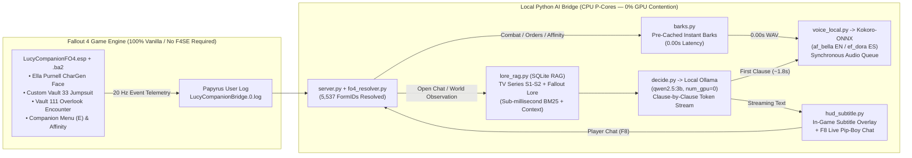

# Fallout 4 — Lucy MacLean (Vault 33): 100% Local Generative AI & Voice Companion
### Compañera Completa con IA Generativa y Voz en Tiempo Real 100% Local (Ediciones en Inglés y Español)

[](LICENSE)
[](#universal-compatibility)
[](#hardware--performance)
[](#hardware--performance)

> **🌍 Language Navigation / Navegación de Idioma:**
> - 🇺🇸 **[English Documentation (Complete Guide, Architecture & Installation)](#english-documentation)**
> - 🇪🇸 **[Documentación en Español (Guía Completa, Arquitectura e Instalación)](#documentación-en-español)**
> - 🎬 **[Watch the Real-Time In-Game Video Showcase on YouTube / Ver Vídeo de Demostración en YouTube](https://youtu.be/JSrjqPxMAB4)**
> - 📦 **[Download on Nexus Mods (Fallout 4 Mod #110865)](https://www.nexusmods.com/fallout4/mods/110865)**

[](https://youtu.be/JSrjqPxMAB4)

---

<a name="english-documentation"></a>
# 🇺🇸 English Documentation

## 1. Overview: A New Era for In-Game Companions
**Lucy MacLean (Vault 33) — Local Generative AI Companion** brings **Lucy MacLean** from the *Fallout* TV series into **Fallout 4** as a **complete, lore-friendly companion** powered by **real-time, 100% local Generative AI, persistent SQLite RAG memory, and real-time neural voice synthesis**.

Unlike traditional scripted companions limited to a fixed dialogue tree—or cloud-dependent AI mods that require paid API keys and suffer from network lag—this project runs **100% locally on your own PC**:
- **🔒 100% Offline & Zero Cloud Dependency:** No OpenAI/ElevenLabs subscriptions, no API keys, no internet connection required during gameplay, and **$0.00 cost forever**.
- **⚡ Smooth Performance on Mid-Range Hardware (RTX 3060):** Specifically engineered and benchmarked on a **mid-range, previous-generation GPU (NVIDIA GeForce RTX 3060 12 GB + Intel Core i7-12700)**. By running token-streamed LLM inference (`qwen2.5:3b`) and neural TTS (`Kokoro-ONNX 82M`) on CPU P-cores (`num_gpu=0`), **Fallout 4 keeps 100% of your GPU's 3D pipeline and VRAM** with **zero frame drops** (`0.00s` latency on gameplay barks and `~1.8s` Time-To-First-Audio on open-ended live chat).
- **💬 Real-Time Open Conversation (`F8` Live Chat) + Spoken Voice:** Press **`F8`** at any moment to open an in-game Pip-Boy terminal, type **any question or comment**, and hear Lucy answer you **in her own voice** clause-by-clause while her response streams onto your screen.
- **🧠 Deep Persistent SQLite RAG Memory (TV Series Seasons 1 & 2 + Fallout Lore):** Lucy remembers every detail of her life in Vault 33, her father Hank MacLean's betrayal at Shady Sands, Cooper Howard (The Ghoul) cutting off her finger outside the Super Duper Mart and selling her to Snip-Snip, Maximus, her brother Norm discovering "Bud's Buds" in Vault 31, and her pursuit of Hank to New Vegas—while respecting strict **anti-spoiler rules** so she never spoils Fallout 4 quests you haven't played yet.
- **🤝 Complete Native Fallout 4 Companion Mechanics:**
  - **Vault 111 Exterior Overlook Encounter:** Find Lucy waiting by the exterior control console outside Vault 111 after she tracks your cryogenic pod's depressurization signal from a Vault-Tec terminal in New Vegas.
  - **Interactive Recruitment & Companion Menu (`E`):** Choose whether to recruit her now or leave her waiting at the Vault 111 overlook. When recruited, press **`E`** on her to ask her opinion of your surroundings, hear a story, trade gear (`OpenInventory`), toggle Follow/Wait, check your Affinity score, or dismiss her.
  - **Real-Time Affinity System (`0..1000`) & Permanent Companion Perk:** Reacts in real time to your actions (completing quests, hacking terminals, picking locks, building settlements, upgrading gear vs. murder, pickpocketing, trespassing, or chem addiction) and awards the permanent **"The Golden Rule (Vault 33)"** Perk at `1000 / 1000` Affinity (+100% Speech XP, +100% Location Discovery XP, +15% self-defense damage).
  - **Instant Iconic Voice Barks (`0.00s` Latency):** Pre-cached neural audio for combat start (*"Okey-dokey, let's get to it!"*), post-combat victory (*"All dispatched! Okey-dokey, we made it through in one piece!"*), recruitment, orders, and affinity reactions.

---

## 2. Two 100% Independent Standalone Editions Included
This repository includes **two completely separated, standalone editions** so there is never any language mixing or translation delay:

| Folder | Edition | Voice Engine | In-Game `.esp`/`.ba2` | Live Chat (`F8`) & RAG DB |
| :--- | :--- | :--- | :--- | :--- |
| **[`english_edition/`](english_edition/)** | **100% Pure English Edition** | `af_bella` (`lang="en-us"`) | 100% English Menus, Perk & Journal | 100% English Prompts & 16 English RAG Cards |
| **[`spanish_edition/`](spanish_edition/)** | **100% Pure Spanish Edition (Castellano)** | `ef_dora` (`lang="es"`) | 100% Spanish Menus, Perk & Journal | 100% Spanish Prompts (with `ñ`, accents & `¿¡`) & 16 Spanish RAG Cards |

---

## 3. System Architecture & How It Works



---

<a name="hardware--performance"></a>
## 4. Hardware Benchmark & Zero-Cloud Design
One of the core goals of this project is proving that **next-generation interactive AI companions do not require expensive cloud APIs or flagship $2,000 GPUs**:

| Component | Tested Hardware (Mid-Range Setup) | Resource Allocation | Measured Latency |
| :--- | :--- | :--- | :--- |
| **Fallout 4 (Ultra, 1080p/1440p)** | **NVIDIA GeForce RTX 3060 (12 GB)** | **100% Dedicated GPU** (`0 MB` VRAM stolen by AI) | Locked **60 FPS** (0 stutter) |
| **Iconic Gameplay Barks** (`barks.py`) | **Disk WAV Cache -> `winsound`** | `0%` CPU / `0%` GPU | **`0.00s` (`~6–40 ms`)** |
| **Persistent Lore RAG** (`lore_rag.py`) | **SQLite + In-Memory BM25/Bigram** | `< 5 MB` RAM | **`< 1 ms`** |
| **Local LLM Streaming** (`qwen2.5:3b`) | **Intel Core i7-12700 (8 P-Cores)** | `num_gpu=0`, `num_thread=8`, `num_ctx=1536` | **`~13–15 tokens/s`** (`~1.5s` first clause) |
| **Local Neural Voice** (`Kokoro-ONNX 82M`) | **CPU ONNX Runtime** | Synthesizes clause 1 while clause 2 generates | **`~180–250 ms`** per clause (**`~1.8s` total TTFA**) |

---

## 5. Tools & Prerequisites
To run the mod and the local AI bridge on Windows 10/11, you only need free, open-source local tools:

1. **Fallout 4 (PC — Steam or GOG):**
   - Compatible out of the box with both **`1.10.163` (Pre-Next-Gen / GOG)** and **`1.10.980+` (Next-Gen / Anniversary Edition)**.
   - Requires **only** `Fallout4.esm` (zero DLC, zero Creation Club, and zero F4SE dependencies).
2. **[Ollama](https://ollama.com/) (Local LLM Runner):**
   - Download and install Ollama for Windows, then open a terminal and pull the lightweight `qwen2.5:3b` model (~1.9 GB):
     ```powershell
     ollama pull qwen2.5:3b
     ```
3. **[eSpeak NG](https://github.com/espeak-ng/espeak-ng/releases) (Phonemizer for Kokoro-ONNX):**
   - Download and run the Windows `.msi` installer (`espeak-ng-X64.msi`), which installs to `C:\Program Files\eSpeak NG`.
4. **Python 3.10+:**
   - Install the lightweight Python dependencies from the repository root:
     ```powershell
     pip install -r requirements.txt
     ```
   - *(Note: On first launch, `voice_local.py` automatically downloads the official `kokoro-v1.0.onnx` and `voices-v1.0.bin` files into `bridge/models/kokoro/` if they are not already present).*

---

## 6. Step-by-Step Installation & Usage (English Edition)

### Step 1: Enable Fallout 4 Papyrus User Logging
Run the included helper script once to ensure `bEnableLogging=1` and `bEnableTrace=1` are set in your `Fallout4Custom.ini`:
```powershell
python english_edition/bridge/setup_fo4_ini.py
```

### Step 2: Install the Mod Files into `Fallout 4\Data`
You can either **copy the pre-built files** from [`english_edition/build_out/`](english_edition/build_out/):
- `LucyCompanionFO4.esp`
- `LucyCompanionFO4 - Main.ba2`
- `LucyCompanionFO4 - Textures.ba2`

into your `Fallout 4\Data` folder and enable `*LucyCompanionFO4.esp` in your mod manager / `plugins.txt`, **OR** run the automated builder/installer script:
```powershell
python english_edition/build_lucy_mod.py --install
```

### Step 3: Start the Local AI Bridge Server
Run **`python start_lucy_bridge.py`** (or `python bridge/server.py`) and **`python open_lucy_chat.py`** inside the `Lucy_AI_Bridge_EN` folder.
- The live Pip-Boy chat window and subtitle overlay will appear on your screen.

### Step 4: Meet, Recruit & Chat with Lucy in Fallout 4!
1. **Meet Lucy Outside Vault 111:** Walk out of Vault 111 (or fast-travel to Vault 111 on an existing save). Lucy is waiting right next to the **Vault 111 exterior elevator control console** (`~12.5m` off the elevator platform). *(You can also use **`[Lucy] 4. Call / Summon Lucy Here`** in your Pip-Boy `Aid` tab to bring her directly to you).*
2. **Recruit Her (`E`):** Walk up to her and press **`E`** to read her story and recruit her as your companion (*"Okey-dokey, let's get to it!"*), or leave her waiting at the Vault 111 overlook until you need her.
3. **Companion Menu (`E`):** Anytime she is traveling with you, press **`E`** on her to open her 7-option Companion Menu (Ask opinion, Tell story, Trade inventory, Follow/Wait, Check Affinity & Perk, Dismiss).
4. **Live Interactive Voice & Text Chat (`F8`):** Press **`F8`** at any moment to open the live Pip-Boy chat window, type any question in English, press **`Enter`**, and hear Lucy respond in real time! Press **`ESC`** or **`F8`** to minimize the chat and return to gameplay.

---
---

<a name="documentación-en-español"></a>
# 🇪🇸 Documentación en Español

## 1. Descripción General: Un Antes y un Después en Compañeros para Videojuegos
**Lucy MacLean (Refugio 33) — Compañera con IA Generativa Local** integra a **Lucy MacLean** (protagonista de la serie de TV *Fallout*, interpretada por Ella Purnell) dentro de **Fallout 4** como una **compañera completa** dotada de **inteligencia artificial generativa en tiempo real, memoria persistente RAG en SQLite y síntesis de voz neuronal 100% local**.

A diferencia de los compañeros tradicionales limitados a frases pregrabadas —o de los mods de IA basados en la nube que exigen pagar suscripciones o claves API externas—, **todo el sistema se ejecuta al 100% en local dentro de tu propio PC**:
- **🔒 100% Local, Sin Nube y Coste Cero (`0 €`):** Sin conexión a servidores externos, sin claves API de pago, sin telemetría y totalmente gratuito para siempre.
- **⚡ Rendimiento Fluido en Tarjetas de Gama Media (Probado en NVIDIA RTX 3060 12 GB):** Diseñado específicamente para funcionar con total fluidez en equipos con gráficas de gama media que no son de última generación (como una **RTX 3060**) junto a un procesador multinúcleo (`i7-12700`). Al asignar la inferencia del modelo de lenguaje (`qwen2.5:3b`) y el motor de voz (`Kokoro-ONNX 82M`) a los núcleos P de la CPU (`num_gpu=0`), **Fallout 4 conserva el 100% de la tarjeta gráfica y su memoria VRAM**, logrando **60 FPS estables**, **`0.00s` de latencia** en frases de combate/órdenes y **`~1.8s` hasta el primer audio (TTFA)** en conversación libre.
- **💬 Conversación Abierta en Tiempo Real (`F8`) con Voz:** Pulsa **`F8`** en cualquier momento para abrir una ventana estilo Pip-Boy, escribe cualquier pregunta o comentario (con soporte completo para tildes, `ñ` y `¿¡`) y escucha a Lucy responderte con su voz en tiempo real cláusula por cláusula.
- **🧠 Memoria Persistente RAG en SQLite (Temporadas 1 y 2 de la Serie + Lore de Fallout):** Lucy recuerda con precisión toda su vida en el Refugio 33, el secuestro y la traición de su padre Hank MacLean en Shady Sands, cómo Cooper Howard (El Necrófago) la torturó, le cortó el dedo índice frente al Super Duper Mart y la vendió a *Snip-Snip*, su viaje con Maximus, el descubrimiento de su hermano Norm en el Refugio 31 (*«Los Colegas de Bud»*) y su llegada a New Vegas, manteniendo además **protección estricta contra spoilers** de las misiones de Fallout 4 que aún no hayas jugado.
- **🤝 Mecánicas Completas de Compañera de Fallout 4:**
  - **Encuentro e Historia en la Explanada Exterior del Refugio 111:** Lucy te espera junto al puesto de control exterior del ascensor del Refugio 111 tras haber rastreado la señal de apertura de tu cápsula criogénica desde una terminal de Vault-Tec en New Vegas.
  - **Menú de Reclutamiento y Menú de Compañera al pulsar `E`:** Decide al conocerla si quieres que viaje contigo (*«¡Oki-doki, vamos al lío!»*) o que te espere allí para más adelante. Una vez reclutada, pulsa **`E`** sobre ella para pedirle opinión sobre el lugar actual, escuchar una historia, intercambiar equipo (`OpenInventory`), alternar *Seguirme / Esperar aquí*, consultar vuestra Afinidad o despedirla.
  - **Sistema de Afinidad en Tiempo Real (`0..1000`) y Ventaja Especial Permanente:** Reacciona al instante ante tus acciones (completar misiones, hackear terminales, forzar cerraduras, mejorar equipo o construir en asentamientos frente a asesinatos, robos, allanamientos o adicciones) y al llegar a `1000 / 1000` te otorga la ventaja permanente **«La Regla de Oro (Refugio 33)»** (doble de XP en persuasión y al descubrir ubicaciones + +15% de daño en defensa propia).
  - **Frases Icónicas Instantáneas fuera del Chat (`0.00s` de latencia):** Audios pre-cacheados para el inicio de combate (*«¡Oki-doki, vamos al lío! ¡Intentemos no perder ningún dedo esta vez!»*), fin de combate al estilo Codsworth (*«¡Todo despachado! ¡Oki-doki, hemos salido de una pieza!»*), órdenes y reacciones de afinidad.

---

## 2. Dos Ediciones 100% Independientes Incluidas
El repositorio incluye **dos ediciones autónomas y separadas** para garantizar cero mezclas de idioma y máxima velocidad:
- **[`spanish_edition/`](spanish_edition/) (Edición Íntegra en Español):** Plugin `.esp`/`.ba2` en español, voz femenina en español (`ef_dora`, `lang="es"`), base RAG en español y ventana de chat `F8` en español.
- **[`english_edition/`](english_edition/) (Edición Íntegra en Inglés):** Plugin `.esp`/`.ba2` en inglés, voz femenina en inglés (`af_bella`, `lang="en-us"`), base RAG en inglés y ventana de chat `F8` en inglés.

---

## 3. Herramientas Necesarias e Instalación Paso a Paso (Edición en Español)

### Requisitos Previos (100% Gratuitos y Locales)
1. **Fallout 4 para PC (Steam o GOG):** Compatible de forma nativa tanto con la versión **`1.10.163`** como con **`1.10.980+` (Next-Gen / AE)**. Solo requiere `Fallout4.esm` (sin DLCs, sin Creation Club y sin F4SE).
2. **[Ollama](https://ollama.com/):** Instálalo en Windows y descarga el modelo ligero `qwen2.5:3b` (~1.9 GB):
   ```powershell
   ollama pull qwen2.5:3b
   ```
3. **[eSpeak NG](https://github.com/espeak-ng/espeak-ng/releases):** Instala el paquete `espeak-ng-X64.msi` en su ruta por defecto (`C:\Program Files\eSpeak NG`).
4. **Python 3.10+:** Instala las dependencias ligeras desde la raíz del repositorio:
   ```powershell
   pip install -r requirements.txt
   ```

### Paso 1: Activar el Log de Usuario de Papyrus en Fallout 4
Ejecuta una sola vez el script de configuración automática:
```powershell
python spanish_edition/bridge/setup_fo4_ini.py
```

### Paso 2: Instalar los Archivos del Mod en `Fallout 4\Data`
Puedes copiar directamente los 3 archivos ya compilados de [`spanish_edition/build_out/`](spanish_edition/build_out/) (`LucyCompanionFO4.esp`, `LucyCompanionFO4 - Main.ba2` y `LucyCompanionFO4 - Textures.ba2`) a tu carpeta `Fallout 4\Data`, o ejecutar el instalador automático:
```powershell
python spanish_edition/build_lucy_mod.py --install
```

### Paso 3: Iniciar el Servidor Puente de IA Local
Ejecuta **`python iniciar_lucy_bridge.py`** (o `python bridge/server.py`) y **`python abrir_chat_lucy.py`** dentro de la carpeta `Lucy_AI_Bridge_ES`.
- Verás aparecer la ventana interactiva de comunicaciones Pip-Boy y los subtítulos HUD en pantalla.

### Paso 4: ¡Juega, Recluta a Lucy y Chatea en Tiempo Real!
1. **Encuentro en el Refugio 111:** Al salir del ascensor del Refugio 111 (o viajando rápido al Refugio 111 en tu partida actual), encontrarás a Lucy esperando junto a la consola de control exterior del Refugio 111. *(También puedes usar el objeto **`[Lucy] 4. Llamar / Acercar a Lucy aquí`** en la pestaña `Ayuda` de tu Pip-Boy).*
2. **Reclutamiento y Menú de Compañera (`E`):** Pulsa **`E`** sobre ella para conocer su historia, reclutarla como compañera o darle órdenes e intercambiar inventario.
3. **Chat Libre por Voz (`F8`):** Pulsa **`F8`** en cualquier momento para escribir cualquier pregunta y escuchar a Lucy contestarte con su voz en tiempo real.

---

<a name="universal-compatibility"></a>
## 📜 Open Modding Policy, Universal Compatibility & Credits
- **100% Open Permissions (MIT License):** Free to use, modify, translate, and redistribute.
- **Universal Fallout 4 Compatibility:** Built with `HEDR v1.0` and `BA2 v1` (`GNRL` & `DX10 v1`) for native compatibility across Fallout 4 `1.10.163` and `1.10.980+` (Next-Gen/AE) with zero Creation Club requirements.
- **Full Credits:** See **[CREDITS.md](CREDITS.md)** for full attribution to **Bagomojo** (`rdr2-companion`), **Ollama / Qwen**, **Kokoro-ONNX**, **eSpeak NG**, and **Bethesda Game Studios**.
